<div align="center">

# 无人值守图书馆 · Unmanned Library

**An unattended, IoT-driven library system: self-service kiosk, operations console and live wallboard — built around an explicit software architecture.**


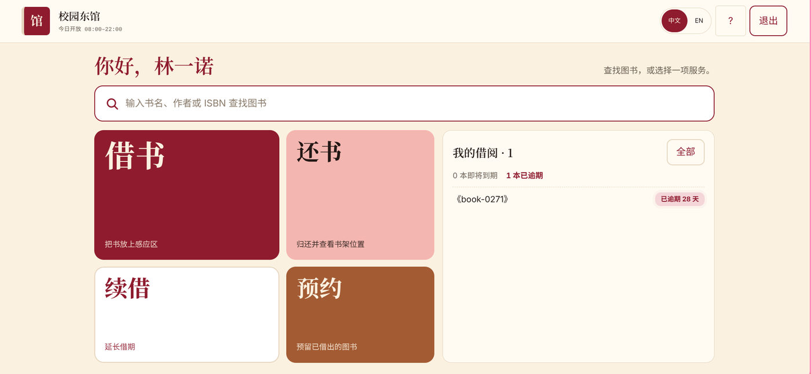

</div>

## What it is

A university-style library that runs with **no staff on site**. Readers borrow, return, renew and reserve books at a kiosk; devices (RFID readers, gates, cameras, smoke and humidity sensors, smart shelves) report to a central system; librarians watch an operations console and a wallboard; and everything keeps working when the network drops.

It was built for a Software Architecture course, so the emphasis is on **architecture decisions driven by quality attributes** — each one documented, measured, and reviewed with ATAM — rather than on feature count.

| | |
|---|---|
| **3** branches | **300** books · **60** readers |
| **25** simulated devices | **3** roles: reader, librarian, admin |

## Screenshots

| Reader sign-in (card number + PIN) | Borrowing: confirm |
|---|---|
| 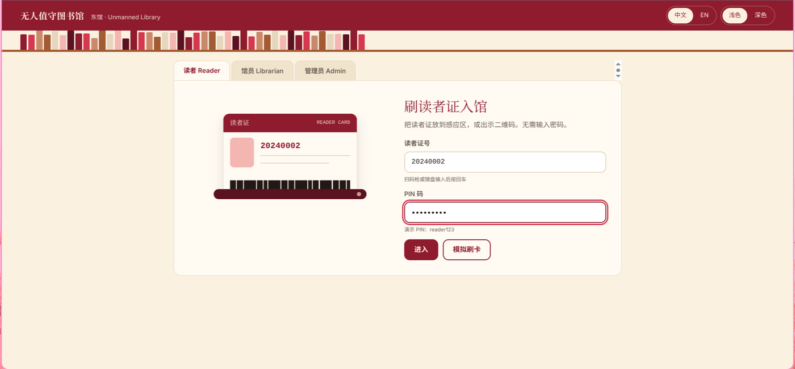 | 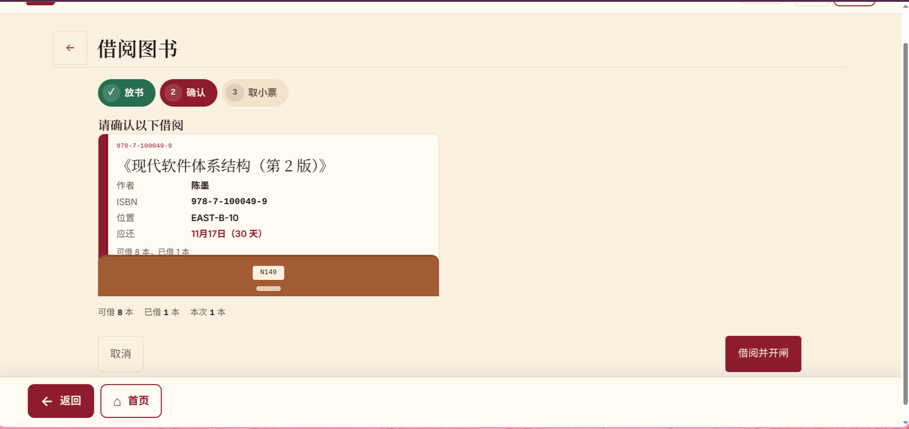 |
| **Borrowing: success** | **Return, with overdue fee** |
| 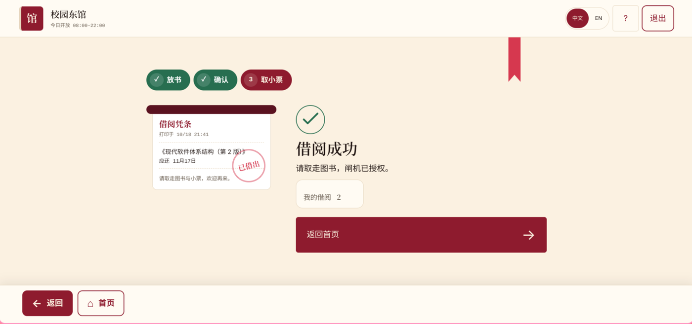 | 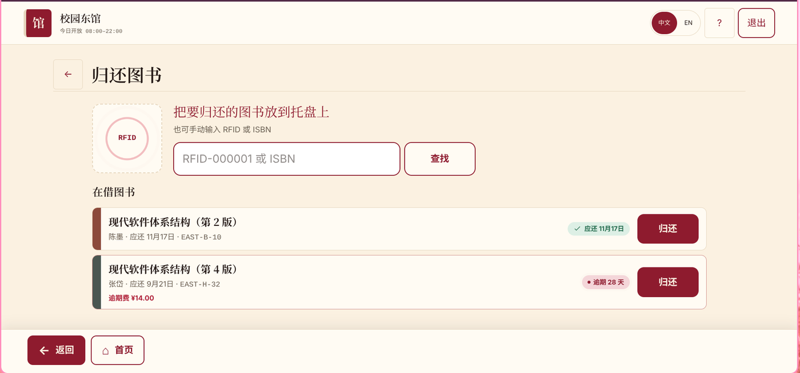 |
| **Operations overview** | **Alerts board** |
| 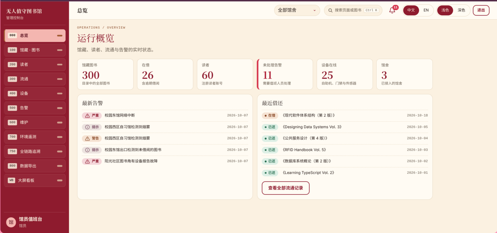 | 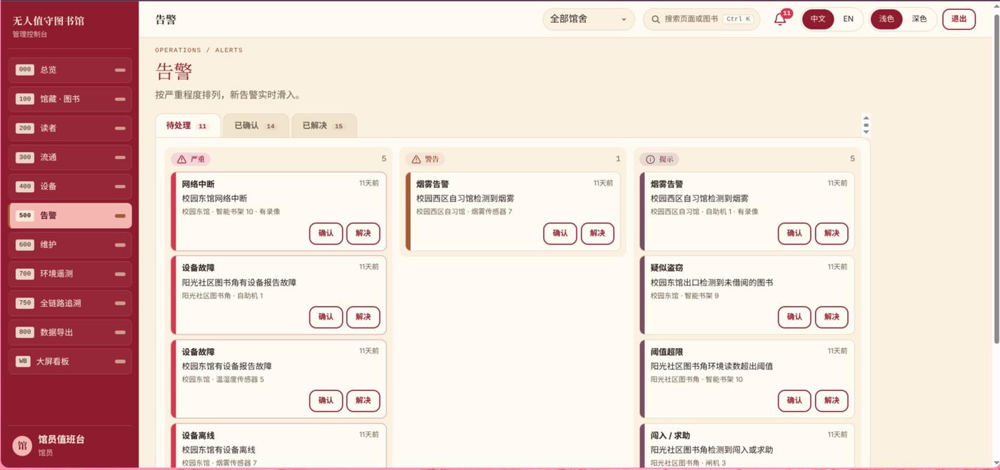 |
| **Devices** | **Live wallboard** |
| 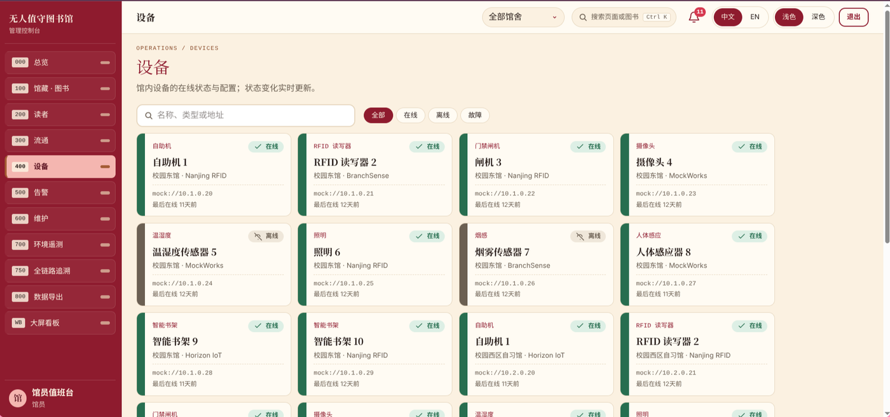 | 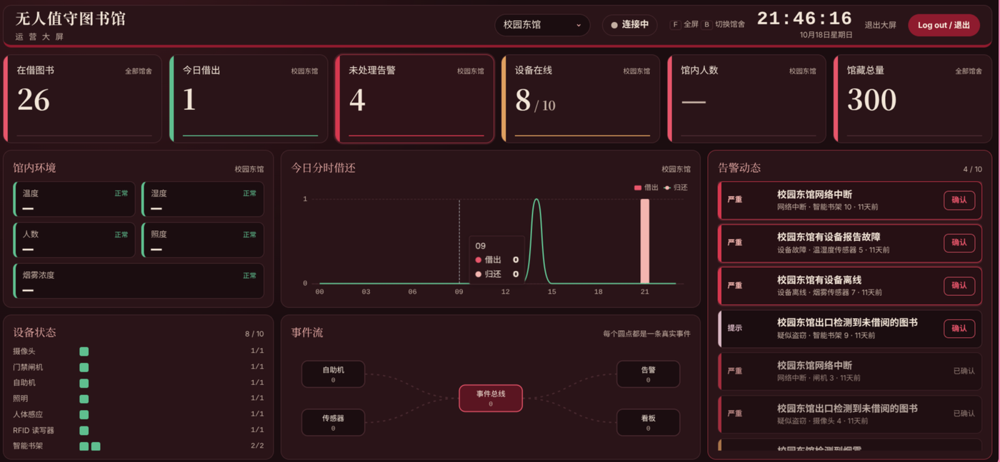 |

The UI switches between Chinese and English and between light and dark themes. Reader card numbers and e-mails are masked in admin lists.

## Architecture

Layered monolith with an in-process **event bus**, chosen so it runs on one modest machine and keeps working offline.

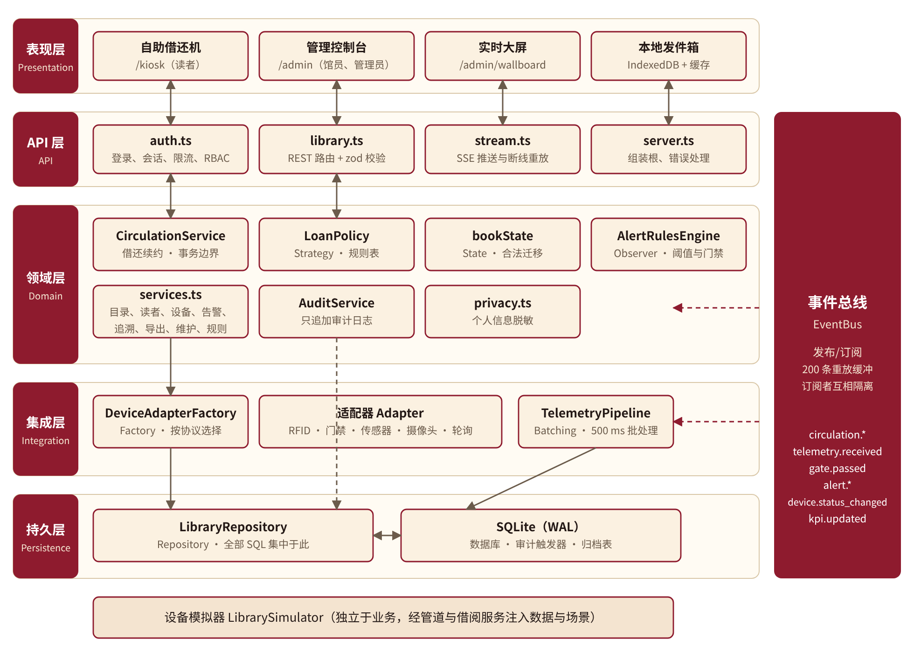

| Concern | Decision |
|---|---|
| Device diversity | **Adapter + Factory**: a protocol adapter per vendor; the domain never sees vendor formats |
| Changing borrowing rules | **Strategy**: rules live in a table (loan period, renewals, fines) — change a rule without a deploy |
| Realtime alerts and KPIs | **Observer / pub-sub** event bus feeding alert rules, telemetry and the wallboard over SSE |
| Data access | **Repository** over SQLite (WAL); in-memory DB for tests |
| Book and kiosk lifecycles | **State machines** that allow only legal transitions |
| Network loss at the kiosk | **Outbox + idempotency key**: borrows are queued locally and replayed |
| Telemetry bursts | Queue with 500 ms batching, so spikes do not lose data |
| Security | **RBAC** (60 routes × 4 roles checked in tests), append-only audit log, PII masking, rate limiting and lockout |

<details>
<summary><b>More diagrams</b></summary>

| System context | Data model |
|---|---|
| 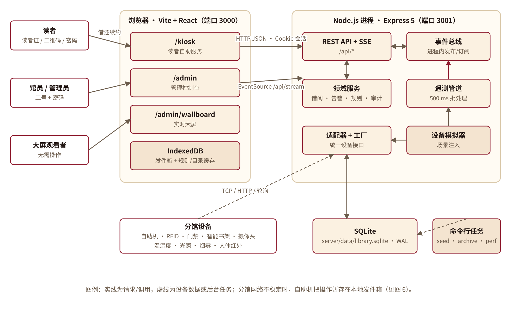 | 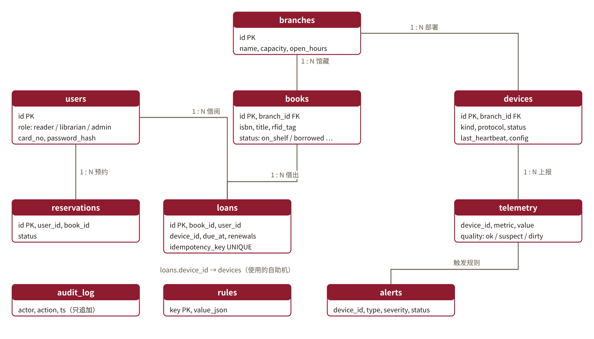 |
| **Kiosk state machine** | **Borrow sequence** |
| 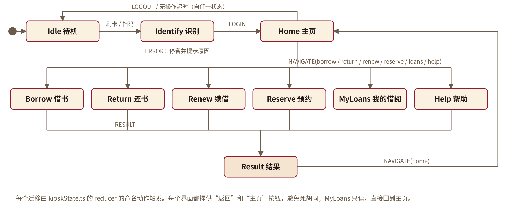 | 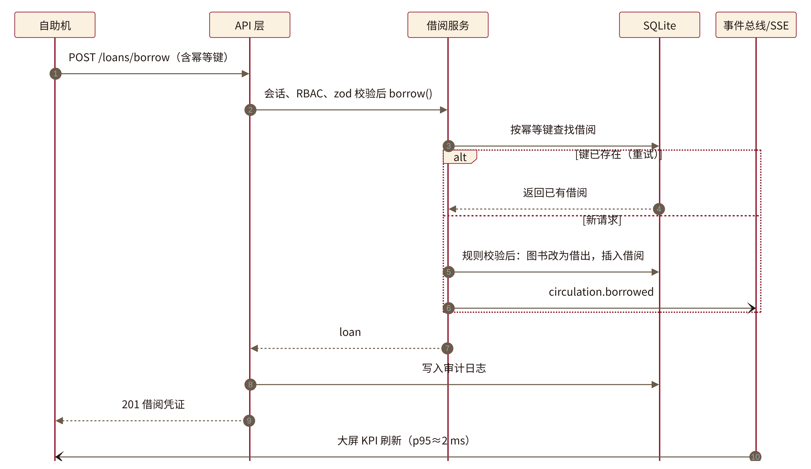 |

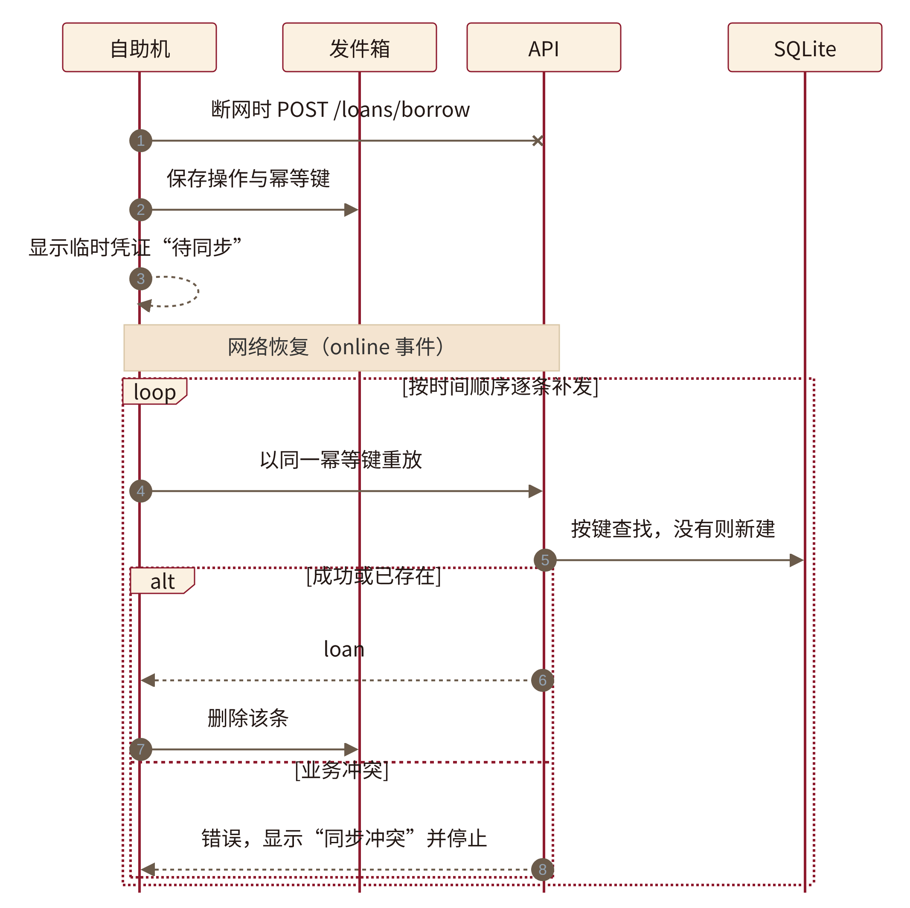

</details>

## Measured results

From `npm run perf` on a development machine, plus the automated test suite.

| Quality attribute | Result |
|---|---|
| Borrow latency | **p95 ≈ 23 ms** (target ≤ 1 s) |
| Event → wallboard (SSE) | **≈ 2 ms** |
| Telemetry burst | 11,000 / 11,000 readings stored during a 500-reading/s burst |
| Authorization | 240 RBAC checks (60 routes × 4 roles) |
| Server tests | 301 passing |

Numbers are from a local single-machine run, not a production benchmark.

## Run it

Requires **Node 20+**.

```bash
git clone https://github.com/jeren001/unmanned-library.git
cd unmanned-library
npm install
npm run seed                 # demo data: 3 branches, 300 books, 60 readers, devices
DEMO_MODE=true npm run dev   # web on http://localhost:3000, API on :3001
```

Demo mode shows sign-in hints and enables the simulated card scan; without it, hints are hidden and typed card numbers always require a PIN.

| Role | Sign in with |
|---|---|
| Reader | card number `20240002` + PIN `reader123` (or the “simulate card” button in demo mode) |
| Librarian | `librarian` / `librarian123` |
| Admin | `admin` / `admin123` |

These are **seed data for local demos only**.

Other scripts: `npm test` · `npm run build` · `npm run perf` · `npm run archive`.

Use the **Simulator** page in the console to inject events (smoke spike, unpaid book at the gate, device failure) and watch alerts and the wallboard react.

## Tech stack

- **Server:** Node, TypeScript, Express 5, better-sqlite3, zod, bcrypt, Vitest, Server-Sent Events
- **Web:** React, Vite, Tailwind, react-i18next, ECharts
- **Data:** SQLite in WAL mode, Excel export with exceljs

## Documentation

The repository ships with the full design record: requirements, architecture (C4-style views, sequence diagrams, quality scenarios), an ATAM review with a utility tree and risk register, and API reference — see [`docs/`](docs/).

## Known limitations

Documented rather than hidden: the offline outbox fully covers borrowing only (returns and renewals are not yet idempotent offline), sessions are not persisted across restarts, the event bus is in-process (lost on a crash), and device protocols are simulated rather than real hardware.

## Author

**任杰 (Jeren)** — Software Engineering, HUST. Built as an individual project: architecture, backend, frontend, tests and documentation.
