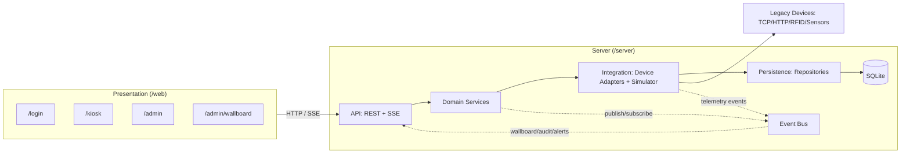

# Architecture

## Style

The system uses a layered architecture with an in-process event-driven spine. Layers keep the prototype understandable for a six-week course project and make architecture decisions visible: UI concerns stay in the web app, API contracts stay in Express, business rules stay in domain services, device variation stays behind adapters, and SQLite access stays behind repositories.

Event-driven behavior is used inside the server for telemetry, circulation, alarms, audit, wallboard refresh, and offline sync. REST handles commands and queries; Server-Sent Events streams live state to the wallboard.

## Layers and Dependencies

| Layer | Responsibility | May call |
|---|---|---|
| Presentation | React routes for login, kiosk, admin dashboard, wallboard; calls REST APIs and listens to SSE. | API only |
| API | Express routes, validation, auth boundary, REST command/query endpoints, SSE streams. | Domain only |
| Domain | Circulation, reader, catalogue, device management, alarm rules, RBAC decisions, audit intent, loan-rule strategies. | Integration only |
| Integration | TCP/HTTP hardware adapters, simulator injection, device factory, event publication, outbox sync coordination. | Persistence only |
| Persistence | Repository interfaces/implementations over SQLite, append-only audit log, outbox table, history/export queries. | SQLite only |
| Events | In-process publish/subscribe bus used across server components for notifications, not as a replacement for layer calls. | No business logic |

Rule: upper layers may call only the layer directly below. Cross-cutting realtime behavior must publish events to the event bus instead of reaching across layers.

## Folder Layout

| Path | Layer |
|---|---|
| `/web/src/kiosk` | Presentation: reader kiosk |
| `/web/src/admin` | Presentation: admin and wallboard |
| `/web/src/shared` | Presentation shared UI/API client/i18n helpers |
| `/server/src/api` | API: REST, SSE, request validation |
| `/server/src/domain` | Domain services, entities, policies, state transitions |
| `/server/src/integration` | Device adapters, adapter factory, hardware clients |
| `/server/src/simulator` | Deterministic device simulator and scenario injection |
| `/server/src/persistence` | SQLite repositories, migrations, export queries |
| `/server/src/events` | In-process event bus and event contracts |
| `/docs` | Requirements, architecture, review, reflection |

## Patterns

| Pattern | Where used | Problem solved | Quality attribute |
|---|---|---|---|
| Adapter | `/server/src/integration` device adapters for TCP/HTTP/RFID/sensors | Normalizes legacy hardware behind one device interface | Modifiability, availability |
| Factory | `/server/src/integration` adapter factory | Creates the correct adapter from device type/config | Modifiability, testability |
| Strategy | `/server/src/domain` loan rules and alarm threshold policies | Changes renew/overdue/reservation rules without code changes | Modifiability, performance |
| Observer/Pub-Sub | `/server/src/events` event bus | Decouples telemetry/circulation from wallboard, alerts, audit | Performance, testability |
| Repository | `/server/src/persistence` SQLite repositories | Hides SQL and keeps domain independent from storage details | Testability, modifiability |
| State | `/server/src/domain` book/device/loan states | Controls valid transitions such as on-shelf -> borrowed or online -> offline | Security, availability |
| Outbox | `/server/src/persistence` + `/server/src/domain` idempotency keys | Preserves kiosk operations during intermittent network and retries safely | Availability, security |

## Priority Split

| Priority | Components |
|---|---|
| P0 | Login/auth/RBAC, kiosk borrow/return/renew, book catalogue, reader records, device registration/status/faults, TCP/HTTP adapters, gate alarms, history query/export, wallboard live overview, SQLite repositories, event bus, audit log, outbox/idempotency. |
| P1 | Environment curves and aggregation, dirty data flags, reservations, archive jobs, maintenance logs, data correlation with placeholder camera clips, simulator scenario buttons. |
| P2 | Placeholder-only mobile mini-program, AI recommendations, smart lighting/AC linkage. |
