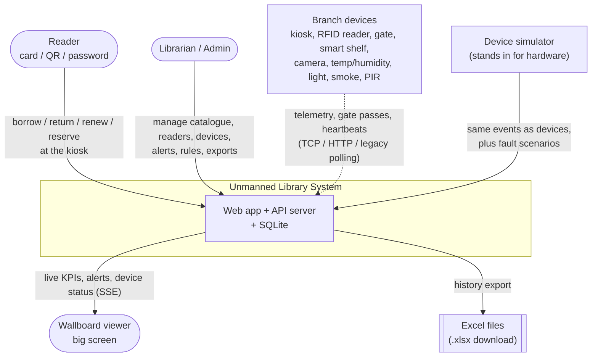
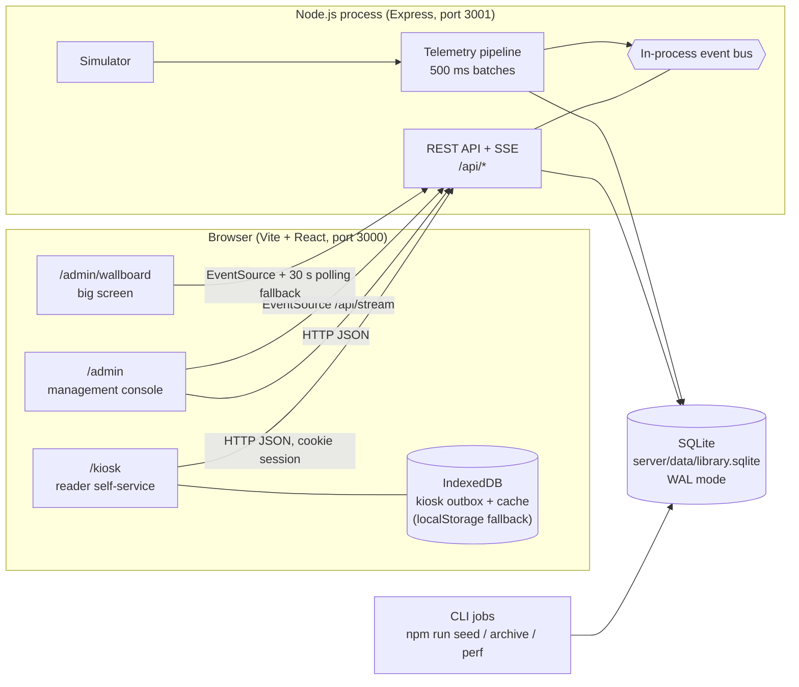
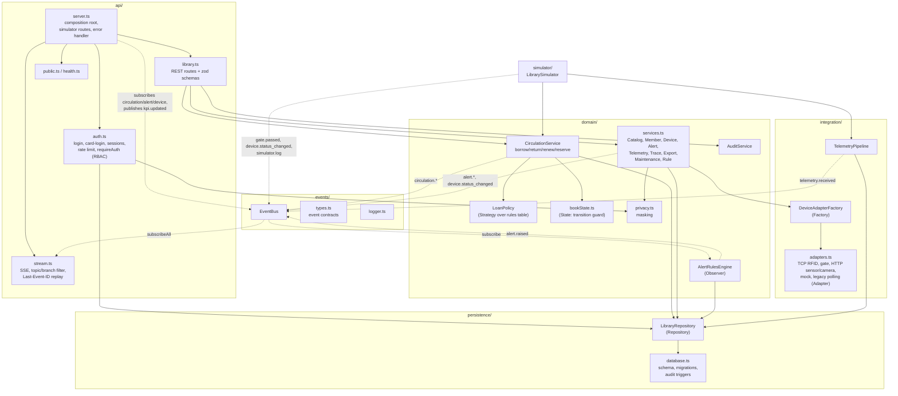
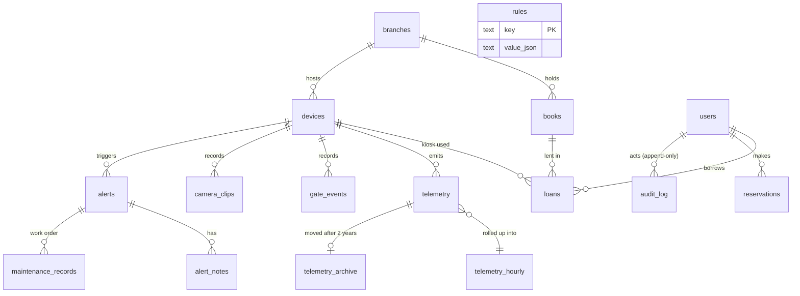
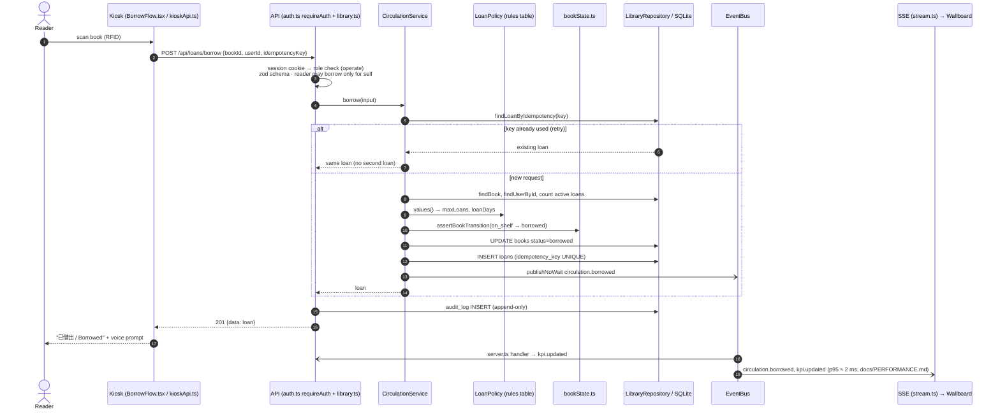
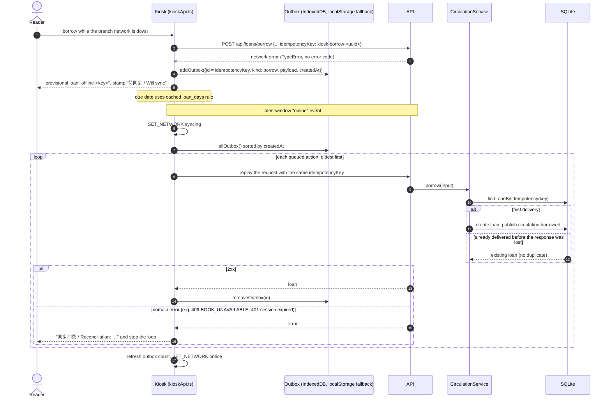
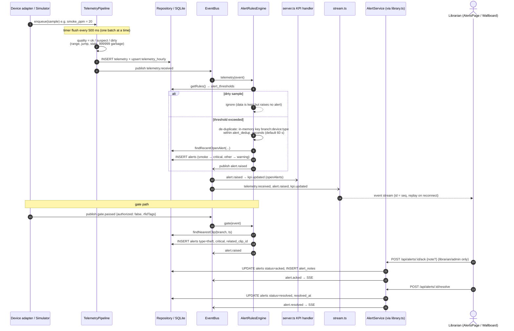

# Architecture

## Style

The system uses a layered architecture with an in-process event-driven spine.
REST handles commands and queries. An in-process publish/subscribe bus
(`server/src/events/bus.ts`) connects telemetry, circulation, gate events and
device status to the alert rules, the KPI feed and the SSE stream. Server-Sent
Events (`GET /api/stream`) push live state to the admin dashboard and wallboard.

Everything runs offline on one machine: one Node.js process, one SQLite file
(`server/data/library.sqlite`), and the Vite web app. There are no cloud
services. Real hardware is replaced by a deterministic simulator behind the same
adapter contract that real devices would use.

The diagrams below are drawn from the code on the `backend` branch (`/server`)
and the `frontend` branch (`/web`). Anything planned but not built is labelled
as such.

## 1. System Context

Branch networks are intermittent, so the kiosk keeps a local outbox and syncs
later (see sequence 5.2).

## 2. Containers

| Container | Technology | Responsibility | Code |
|---|---|---|---|
| Web app | Vite, React, TypeScript, react-i18next, ECharts | Kiosk, admin console, wallboard; dev server proxies `/api` to 3001 | `/web/src` (frontend branch) |
| Kiosk outbox | IndexedDB, falls back to localStorage | Holds borrow/return/renew/reserve actions made while offline | `/web/src/kiosk/kioskApi.ts` |
| API server | Express 5, zod, bcrypt | REST commands/queries, auth/RBAC, SSE, simulator control | `/server/src/api` |
| Event bus | In-process pub/sub with replay buffer (200 events) | Decouples producers from alert rules, KPIs and SSE | `/server/src/events/bus.ts` |
| Telemetry pipeline | In-memory queue, 500 ms flush, hourly rollup | Batches device samples, flags quality, persists, publishes | `/server/src/integration/telemetryPipeline.ts` |
| Simulator | Seeded PRNG, timers | Generates heartbeats, telemetry, gate passes, circulation; runs fault scenarios | `/server/src/simulator/index.ts` |
| Database | SQLite via better-sqlite3 (WAL, foreign keys on) | All persistent state, append-only audit log, telemetry archive | `/server/src/persistence/database.ts` |
| CLI jobs | tsx scripts | Seed demo data, archive old telemetry, measure performance | `/server/src/seed.ts`, `archive.ts`, `perf.ts` |

## 3. Components (API server)

### Layers and allowed dependencies

| Layer | Responsibility | Calls (as built) |
|---|---|---|
| Presentation (`/web`) | Kiosk, admin, wallboard; REST + EventSource | API only |
| API (`/server/src/api`) | Routing, validation, auth/RBAC, SSE, error mapping | Domain; `server.ts` also wires persistence and the simulator as the composition root |
| Domain (`/server/src/domain`) | Business rules, state transitions, policies, alert rules, masking | Persistence (repositories); Integration (adapter factory) for device commands and health checks |
| Integration (`/server/src/integration`) | Device adapters, factory, telemetry pipeline | Persistence; publishes to the event bus |
| Simulator (`/server/src/simulator`) | Fake devices and scenarios | Integration (pipeline), Domain (`CirculationService` for simulated loans), Persistence |
| Persistence (`/server/src/persistence`) | SQL, schema, append-only audit log, archive | SQLite only |
| Events (`/server/src/events`) | Pub/sub, event contracts, logging | No business logic |

The original rule was strict layering (each layer calls only the one directly
below). In the code, the domain calls repositories directly and the simulator
calls a domain service. Both are deliberate shortcuts, recorded in
`docs/RISKS_AND_TRADEOFFS.md` (T1).

## 4. Data Model (main tables)

## 5. Sequences

### 5.1 Borrow at the kiosk (online)

Device adapters are not on this path, so a faulty gate, shelf or sensor cannot
block a borrow. Errors map to `409 BOOK_UNAVAILABLE`, `409 MAX_LOANS_REACHED`,
`404 BOOK_NOT_FOUND` and `403 FORBIDDEN`.

### 5.2 Offline borrow and sync (kiosk outbox)

There is no server-side outbox table or sync endpoint. The server's part is
the idempotency key on borrow (`loans.idempotency_key UNIQUE`). Return and
renew have no idempotency key: a repeated return is harmless (the loan is
already returned), but a repeated renew is not. These gaps are risks R2 and
R3 in `docs/RISKS_AND_TRADEOFFS.md`.

### 5.3 Alert pipeline (sensor threshold and gate theft)

A device that misses 3 heartbeats becomes `offline` in the simulator tick and
publishes `device.status_changed`; the same engine raises a `device_offline`
alert. `POST /api/devices/:id/health-check` creates a `device_fault` alert and a
draft maintenance record directly in `DeviceService`.

## 6. Folder Layout

| Path | Layer |
|---|---|
| `/web/src/kiosk` | Presentation: reader kiosk, state reducer, outbox client |
| `/web/src/admin` | Presentation: admin console and `/admin/wallboard` |
| `/web/src/shared` | Presentation: shared UI, i18n, icons |
| `/server/src/api` | API: REST, SSE, auth, validation |
| `/server/src/domain` | Domain services, policies, state transitions, alert rules, masking |
| `/server/src/integration` | Device adapters, adapter factory, telemetry pipeline |
| `/server/src/simulator` | Deterministic device simulator and scenario injection |
| `/server/src/persistence` | SQLite schema, migrations, repositories, export and archive queries |
| `/server/src/events` | In-process event bus, event contracts, logger |
| `/docs` | Requirements, architecture, API contract, quality, risks |

## 7. Patterns

| Pattern | Where used | Problem solved | Quality attribute |
|---|---|---|---|
| Adapter | `server/src/integration/adapters.ts` (`TcpRfidAdapter`, `GateControllerAdapter`, `HttpSensorAdapter`, `HttpCameraAdapter`, `MockAdapter`, `LegacyPollingAdapter`) | One `DeviceAdapter` contract over different vendors and protocols | Modifiability, availability |
| Factory | `server/src/integration/factory.ts` | Picks the adapter from `devices.protocol` and `kind` | Modifiability, testability |
| Strategy | `server/src/domain/loanPolicy.ts` + `rules` table; thresholds in `alertRules.ts` | Loan days, limits, renewals and thresholds change through `PUT /api/rules/:key` without code changes | Modifiability |
| Observer / Pub-Sub | `server/src/events/bus.ts`, subscribers in `alertRules.ts`, `server.ts`, `stream.ts` | Producers do not know about alert rules, KPIs or the wallboard; failing handlers are isolated | Performance, availability, testability |
| Repository | `server/src/persistence/repositories.ts` | SQL lives in one place; tests use `:memory:` databases | Testability, modifiability |
| State | `server/src/domain/bookState.ts`; `web/src/kiosk/kioskState.ts` | Only legal book transitions (for example on_shelf → borrowed); named kiosk workflow actions | Security, usability |
| Outbox + idempotency key | `web/src/kiosk/kioskApi.ts` (outbox); `CirculationService.borrow` + `loans.idempotency_key` (dedupe) | Kiosk keeps working offline and retries safely | Availability |
| Batching queue | `server/src/integration/telemetryPipeline.ts` | Bursts of samples are written in batches without loss | Performance |

## 8. Priority Split

| Priority | Components | State |
|---|---|---|
| P0 | Login/auth/RBAC, kiosk borrow/return/renew, catalogue, reader records, device registration/status/faults, adapters, gate alarms, history query/export, wallboard, repositories, event bus, audit log, outbox/idempotency | Built; QR-only login and a server-side sync API are missing |
| P1 | Environment curves, dirty data flags, reservations, archive job, maintenance log, data correlation (trace + placeholder clips), simulator scenarios | Built |
| P2 | Mobile mini-program, AI recommendations, smart lighting/AC linkage | Placeholders only (`docs/API.md`, Missing Endpoints) |
