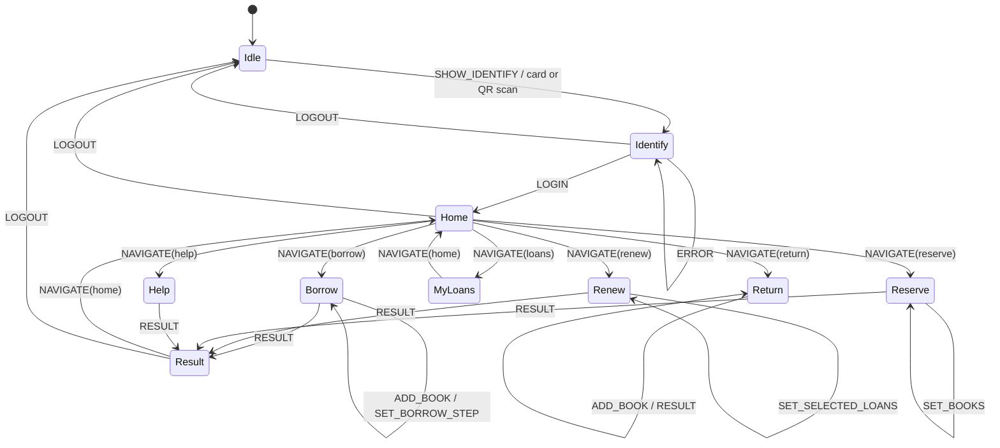

# Kiosk State Machine

The reader kiosk uses a hand-written reducer in `web/src/kiosk/kioskState.ts`.
The reducer is the State pattern boundary: screens do not mutate workflow state
directly, and every transition is represented by a named action.

The inactivity guard in `web/src/kiosk/KioskPage.tsx` dispatches `LOGOUT`
after a warning countdown. It clears the reducer's user, books, loans, and
result state; the API session is also logged out.
